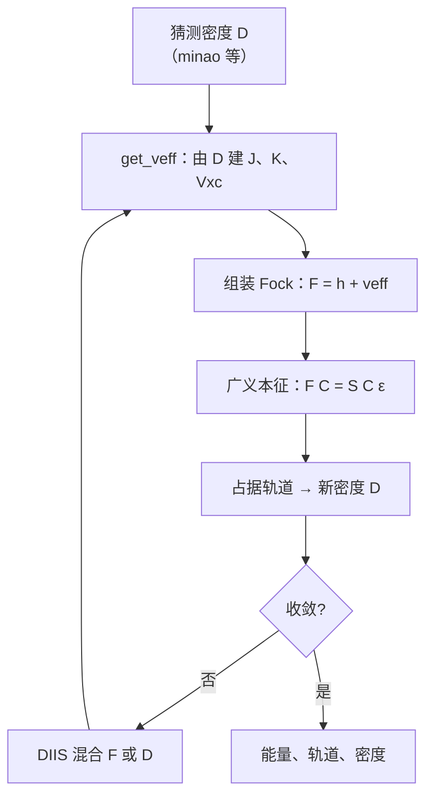

# 从 Hartree–Fock SCF 讲起：面向几乎没有 GPU 编程经验的 GPU4PySCF 优化导读

这份文档假定你大概知道分子量子化学在算什么，但几乎没有写过 CUDA，也没有在 GPU 上优化过积分核。它从闭壳层 Hartree–Fock 自洽场（SCF）开始，解释一次计算的时间究竟花在哪里，一块 GPU 为什么和 CPU 完全不是同一种机器，以及 **Electrolites** 这个仓库对 [GPU4PySCF](https://github.com/pyscf/gpu4pyscf) 做了什么——以及刻意没做什么。

读完之后，你应当能：

- 把「解一个分子的电子结构」翻译成「反复构建 J、K、（DFT 时还有）Vxc」；
- 看懂为什么在这个仓库测量过的体系上，一次 SCF 的墙钟几乎全部在 `get_veff` 里，而对角化、DIIS、格点生成加在一起只有约 2%；
- 用五六个硬件词汇（线程束、寄存器、共享内存、占有率、内核启动、原子加）理解 P1–P5 这类改动为什么能让**同一套积分公式**快上一倍；
- 打开 `README.md` 和各模块的 `docs/README_*.md` 时，知道每一行数字对应哪一段物理、哪一条代码路径。

它**不是**：

- CUDA 教程（不会教你写 `__global__`）；
- 量子化学教科书（HF 只讲到能看懂积分与收缩）；
- 本仓库的测量档案（那些在 `docs/README_fastk.md`、`docs/CATALOGUE_06_STATUS.md` 里，而且写得很密）。

仓库本身是 GPU4PySCF 的一组**可插拔内核替换**：`import electrolites; electrolites.patch_all()` 之后，SCF、梯度、Hessian、响应性质仍然走 GPU4PySCF 的驱动，只是驱动调用的若干入口被换成这里的实现。覆盖不到的情形原样回落到 GPU4PySCF，所以一次打过补丁的计算和没打补丁的计算，算的是同一个量。

---

## 目录

1. [分子量子化学在求什么](#1-分子量子化学在求什么)
2. [Hartree–Fock：平均场里的自洽场](#2-hartreefock平均场里的自洽场)
3. [基组把问题变成四中心积分](#3-基组把问题变成四中心积分)
4. [J 和 K 不是同一种收缩](#4-j-和-k-不是同一种收缩)
5. [SCF 循环，以及时间到底去哪了](#5-scf-循环以及时间到底去哪了)
6. [从 HF 到 DFT：Fock 上再加一块](#6-从-hf-到-dftfock-上再加一块)
7. [GPU 是什么：给量子化学人的硬件课](#7-gpu-是什么给量子化学人的硬件课)
8. [GPU4PySCF 已经做完的事，和还剩的事](#8-gpu4pyscf-已经做完的事和还剩的事)
9. [Electrolites 怎么接到那条路径上](#9-electrolites-怎么接到那条路径上)
10. [两电子积分侧：不改公式，改脚手架（P1–P5）](#10-两电子积分侧不改公式改脚手架p1p5)
11. [覆盖面：为角动量类写核，而不是写一个万能核](#11-覆盖面为角动量类写核而不是写一个万能核)
12. [XC 侧：不是算力不够，是形状不对](#12-xc-侧不是算力不够是形状不对)
13. [从能量到力、Hessian 和响应](#13-从能量到力hessian-和响应)
14. [第三条代码路径，以及「补丁打上了」不等于「跑到了」](#14-第三条代码路径以及补丁打上了不等于跑到了)
15. [这个仓库用来避免自欺的几条方法](#15-这个仓库用来避免自欺的几条方法)
16. [模块地图和阅读顺序](#16-模块地图和阅读顺序)
17. [这个仓库明确不做什么](#17-这个仓库明确不做什么)

---

## 1. 分子量子化学在求什么

非相对论、Born–Oppenheimer 近似下，一个分子的电子结构由定态 Schrödinger 方程决定：

\[
\hat H \Psi = E \Psi
\]

电子 Hamiltonian 包含动能、电子–核吸引、电子–电子排斥。核被看成固定的点电荷；核之间的 Coulomb 排斥 \(V_{\mathrm{nn}}\) 是一个只依赖几何的常数，加在电子能量后面。

精确的 \(\Psi\) 是 \(3N\) 维函数（\(N\) 个电子，每个三个坐标；自旋另算）。对任何化学上有趣的 \(N\)，这张表都存不下，更解不出。实用方法的共同策略是：把「找一个 \(3N\) 维波函数」换成「找 \(N\) 个三维轨道」，再用这些轨道重建能量、密度和力。

Hartree–Fock（HF）是这条路上最干净的一站。Kohn–Sham DFT、杂化泛函、MP2、耦合簇，都在它提供的轨道和平均场语言上往外长。GPU4PySCF——以及这个仓库——优化的对象，绝大部分是 **HF / KS-DFT 的平均场构建**，不是相关能。

---

## 2. Hartree–Fock：平均场里的自洽场

HF 的物理图像：每个电子不再看见其余电子的瞬时位置，而看见它们的**平均电荷分布**。反对称性（Pauli 原理）额外给出一项交换作用。于是 \(N\) 体问题变成一组耦合的单电子方程。

### 2.1 Fock 算符

闭壳层限制性 HF（RHF）里，空间轨道 \(\psi_i\) 满足

\[
\hat F \psi_i = \varepsilon_i \psi_i
\]

Fock 算符分成三块：单电子部分、库仑、交换。口语里说「\(h\) 加 \(J\) 减 \(K\)」；写成 PySCF / GPU4PySCF 用的矩阵时，因为密度已经含每个轨道的两个电子，交换前面还有一个 \(\tfrac12\)，第 2.3 节把因子写死。

- \(\hat h\)：单电子部分（动能 + 核吸引）。每个电子自己付，与其他电子无关，只算一次。
- \(\hat J\)（Coulomb / 库仑）：电子在彼此平均电荷产生的静电势里运动。经典、正、长程。
- \(\hat K\)（exchange / 交换）：来自波函数反对称性，没有经典对应物；它把「相同自旋的电子不要靠太近」写进能量。交换是非定域的：\(\hat K\) 作用在一个轨道上，需要积分里带着**另一个电子的轨道**。

名字容易混：量子化学里说的 *exchange* 几乎总是指 HF 交换 \(\hat K\)，不是 DFT 里的 *exchange–correlation*（XC）。后文会分开写。

### 2.2 为什么叫自洽场（SCF）

\(J\) 和 \(K\) 都依赖于**当前的轨道**（或等价地，依赖于密度）。要求解的方程，其算符又依赖于未知解。做法是迭代：

1. 猜一套轨道（或密度）；
2. 用它建 \(F\)；
3. 对角化 \(F\) 得到新轨道；
4. 用新轨道重建密度，混一点旧的（DIIS 之类），回到 2；
5. 直到密度、能量或轨道梯度不再动。

收敛时，电子看见的平均场，正是由这些电子自己产生的——这就是 *self-consistent field*。

### 2.3 基组：Roothaan–Hall

把每个分子轨道写成原子基函数的线性组合：

\[
\psi_i(\mathbf r) = \sum_\mu C_{\mu i}\, \chi_\mu(\mathbf r)
\]

\(\{\chi_\mu\}\) 是以核为中心的高斯型原子轨道（GTO），\(C\) 是待求的分子轨道系数矩阵。方程变成广义本征问题

\[
F C = S C \varepsilon
\]

- \(S_{\mu\nu} = \langle \chi_\mu | \chi_\nu \rangle\)：重叠矩阵，与密度无关，只算一次。
- \(F_{\mu\nu} = \langle \chi_\mu | \hat F | \chi_\nu \rangle\)：Fock 矩阵，每一轮都要重建。

PySCF / GPU4PySCF 的闭壳层约定里，密度矩阵是**总密度**（每个占据轨道贡献 2 个电子）：

\[
D_{\mu\nu} = 2 \sum_{i \in \mathrm{occ}} C_{\mu i} C_{\nu i}
\]

库仑和交换矩阵是密度与四中心积分的收缩（化学家记号 \((\mu\nu|\lambda\sigma)\)）：

\[
J_{\mu\nu} = \sum_{\lambda\sigma} (\mu\nu|\lambda\sigma)\, D_{\lambda\sigma}
\qquad
K_{\mu\nu} = \sum_{\lambda\sigma} (\mu\lambda|\nu\sigma)\, D_{\lambda\sigma}
\]

闭壳层 Fock 为

\[
F = h + J - \tfrac12 K
\]

总能量可以写成

\[
E = \mathrm{Tr}(h D) + \tfrac12 \mathrm{Tr}\bigl((J - \tfrac12 K) D\bigr) + V_{\mathrm{nn}}
\]

或更省事的等价形式 \(E = \tfrac12 \mathrm{Tr}((h+F)D) + V_{\mathrm{nn}}\)。

有两点后面会反复用到：

- **构建 \(J\) 和 \(K\) 的代价与泛函里 HF 交换的比例无关。** B3LYP 只用 20% 的 \(K\) 装进 Fock，但内核仍然要把整张 \(K\) 算出来再乘 0.2。比例只改算术，不改「要不要走遍那些壳层四元组」。
- **能量公式里的 \(\tfrac12\) 避免双计数**；梯度、Hessian、响应会把同一套积分再收缩一次，但是对着**不同的密度**（有时一次对着很多张密度）。

---

## 3. 基组把问题变成四中心积分

### 3.1 高斯、原函数、收缩、壳层

一个笛卡尔 GTO 看起来像

\[
\chi(\mathbf r) \propto x^\ell y^m z^n \exp(-\alpha r^2)
\]

角动量 \(l = \ell+m+n\) 决定函数长什么样：\(l=0\) 是 s，\(l=1\) 是 p（三个函数），\(l=2\) 是 d，以此类推。同一中心、同一 \(l\)、同一组指数的函数构成一个 **shell（壳层）**。GPU 上的积分从来不是「一个 AO 对一个 AO」地发，而是「一个壳层四元组」地发，因为同一壳层里的函数共享指数和中心，递推可以一起做。

实际基组几乎都是**收缩**的：一个基函数是若干个原高斯（primitive）的固定线性组合。例如 6-31G 里碳的内层 s 由 6 个原函数合成。积分对原函数是四重循环，收缩系数事后乘进去。一对壳层的原函数个数乘积——后文的 **bra primitive pair**——会变成共享内存数组的长度；Pople 基组最坏大约是 \(6\times 6=36\)，def2-QZVP 可以到 100。这个数字与分子有多大无关，只与基组和元素有关。

### 3.2 四中心电子排斥积分（ERI）

两电子排斥积分是

\[
(\mu\nu|\lambda\sigma)
= \int \chi_\mu(\mathbf r_1)\chi_\nu(\mathbf r_1)\,
  \frac{1}{|\mathbf r_1-\mathbf r_2|}\,
  \chi_\lambda(\mathbf r_2)\chi_\sigma(\mathbf r_2)\,
  d\mathbf r_1 d\mathbf r_2
\]

AO 数目为 \(N_{\mathrm{AO}}\) 时，独立积分大约以 \(N_{\mathrm{AO}}^4\) 计。对 2000 个 AO，那是 \(10^{13}\) 量级；存不下，也没有必要存。**Direct SCF** 的做法是：每一轮迭代，现场计算积分并立刻与当前 \(D\) 收缩成 \(J\) 和 \(K\)，算完就丢。GPU4PySCF 走的就是这条路。本仓库优化的，是这条路上的 GPU 核，不是「先把积分存到磁盘」。

### 3.3 筛分（screening）

不是每个四元组都值得算。Schwarz 不等式给出

\[
|(\mu\nu|\lambda\sigma)| \le \sqrt{(\mu\nu|\mu\nu)}\,\sqrt{(\lambda\sigma|\lambda\sigma)}
\]

再乘上密度的局部大小，大量四元组可以在进入积分核之前丢掉。GPU4PySCF 已经做了这件事（`q_cond`、`dm_cond`、任务队列）。**Electrolites 原样沿用这套筛分。** 改筛分会改数值，而这个仓库的正确性标准是：与 GPU4PySCF 的矩阵符合到舍入（交换矩阵大约 \(10^{-14}\) 相对误差）。筛分是算法，不是脚手架；本仓库动的是后者。

### 3.4 角动量类

一个壳层四元组的类型写成 \((l_i l_j | l_k l_l)\)，例如 \((pp|ss)\)、\((ds|pp)\)。每个类的

- Rys 根的个数、
- 要累加的笛卡尔积分个数（`gout` 累加器）、
- 共享内存和寄存器预算

都不同。\((ss|ss)\) 的有效工作几乎就是一次 Boys 函数加一次乘加；\((pp|pp)\) 已经有 81 个累加器。把它们塞进同一个「通用核」、用运行时的表去查下标，代价极高——编译器看不到循环次数，下标不是常量，寄存器也无法按类分配。

这就是为什么 GPU4PySCF 对常见类有**展开的（unrolled）**专用核，其余的走一个通用核；也是为什么本仓库有一整套**按类生成**的 CUDA。

---

## 4. J 和 K 不是同一种收缩

同一张积分表，两种收缩的下标配对完全不同。这不是记号问题，它决定了用哪一种积分算法、核怎么写、多密度时时间如何随密度张数涨。

### 4.1 库仑 \(J\)：密度当电荷

\[
J_{\mu\nu} = \sum_{\lambda\sigma}(\mu\nu|\lambda\sigma) D_{\lambda\sigma}
\]

\((\mu\nu|\) 是「场」这一对 AO，\(|\lambda\sigma)\) 是「源」这一对。物理上这就是：把密度当成电荷分布，算它产生的静电势，再投影回基组。源和场在积分里是分开的，McMurchie–Davidson（MD）方案很合适：先把密度变到 Hermite 高斯上，算 Hermite 空间的势，再变回 AO。GPU4PySCF 的 `j_engine` / `md_j_*` 就是这条路。类用 \((l_{ij}|l_{kl})\) 标记，\(l_{ij}=l_i+l_j\)。

### 4.2 交换 \(K\)：下标交叉

\[
K_{\mu\nu} = \sum_{\lambda\sigma}(\mu\lambda|\nu\sigma) D_{\lambda\sigma}
\]

\(\mu\) 和 \(\nu\) 不在积分的同一侧。没有「先建势再投影」的干净分解，通常直接上 Rys 求积：把 \(1/r_{12}\) 写成一维积分，对每个根做二维递推，再与密度收缩。GPU4PySCF 的 `rys_k_*` 是这条路。类用 \((l_i l_j | l_k l_l)\) 四个角动量标记。

### 4.3 一次 SCF 里它们是分开建的

GPU4PySCF 1.8.1 的 SCF 驱动（`scf/hf.py` 的 `get_veff`）分别调用

- `j_engine._VHFOpt.get_j` → MD 库仑核
- `jk._VHFOpt.get_k` → Rys 交换核

所以优化 SCF，是两件独立的事：`fastj` 和 `fastk`。响应性质走的是**第三条路**——一次扫积分同时累加 J 和 K 的融合核 `get_jk`——那是 `fastjk`，第 14 节再讲。把这三件事当成一件，是这个仓库走过的弯路。

### 4.4 一个对优化极重要的分解

无论 J 还是 K，一次「对 \(n_{\mathrm{dm}}\) 张密度建矩阵」的时间都可以粗分成

\[
T \approx R + n_{\mathrm{dm}}\cdot C
\]

- \(R\)：与密度无关的**积分工作**（Rys 根、Boys 函数、递推、几何预因子）。同一组壳层四元组只做一次。
- \(C\)：把积分与**每一张**密度收缩（读 \(D\)，累加到 \(J\) 或 \(K\)，包括 `atomicAdd`）。

SCF 每轮只有一张密度，\(R\) 占主导，把积分脚手架做快（P1–P5）会得到 2×–3×。Hessian 的 CPHF 一次要 \(n_{\mathrm{dm}} = 3 \times N_{\mathrm{atom}}\) 张密度（42 原子就是 126 张），此时 \(C\) 压过 \(R\)，同一套核只剩约 1.16×——因为 \(C\) 两边是同一段代码。`docs/ROUND4_B4B.md` 把这件事测死了：积分侧再怎么改，也抬不动那个随 \(n_{\mathrm{dm}}\) 线性涨的部分。

---

## 5. SCF 循环，以及时间到底去哪了

把第 2 节写成驱动真正在做的事：



教科书容易让人觉得「对角化 \(F\)」是主角。在本仓库测量的体系上，事情正好相反。

`benchmarks/scf_anatomy.py` 给 GPU4PySCF 1.8.1 的 SCF 驱动里每一个方法两侧都加了 `cudaDeviceSynchronize()`，于是每一行都是可归因的墙钟。284 原子有机团簇 `PfPMT`，B3LYP-D3(BJ)/6-31G\*，2268 AO，A100：

| 步骤 | 占 SCF 墙钟（未打补丁） |
|---|---|
| **`get_veff`（建有效势）** | **97.8%** |
| ↳ 交换 `get_k` | 67.7% |
| ↳ 库仑 `get_j` | 17.7% |
| ↳ XC `nr_rks` | 11.4% |
| ↳ 格点生成 | 0.9% |
| 本征 `eig`（fp64） | 0.8% |
| DIIS | ~0.03% |
| `hcore`、重叠、初猜等 | 0.9% |

**DIIS、对角化、格点生成加在一起约 1.9%。** 优化 SCF 就是优化 `get_veff`，也就是优化 K、J、XC 三块。把对角化再快十倍，你也看不见。

这张表有适用边界，文档后面会反复碰到它们：

- **开壳层过渡金属**上交换可以占 UKS SCF 的 83–88%，XC 掉到 3–5%（`docs/OPENSHELL_TMC.md`）。同样的模块，收益排序会倒过来。
- **含 VV10 的泛函**（wB97M-V 等）会多一项 \(O(n_{\mathrm{grid}}^2)\) 的非局域相关；在极化率里它可以占到整次运行的 80%。
- **响应性质**不走 SCF 的 `get_j` + `get_k`，走融合的 `get_jk`。
- 这是 A100 上、\(N_{\mathrm{AO}}\) 大约 \(10^3\)–\(10^4\)、基组停在 d/f 的测量。消费级卡的 fp64 是峰值的 1/32 而不是 1/2，对角化的份额会按这个比例放大。

还有一个测量陷阱，本仓库自己栽过：用**固定的 minao 密度**上 `get_veff` 的加速比，去除以**收敛 SCF** 的墙钟，会以为有三分之一的时间在 DIIS 和对角化里。minao 密度稀疏得多，筛分狠得多，那个 `get_veff` 根本不是 SCF 迭代里跑的那个。解剖脚本把两件事放在同一次运行里量，才得到上表。`docs/ROUND2_1.8.1.md` §2 是更完整的更正。

---

## 6. 从 HF 到 DFT：Fock 上再加一块

Kohn–Sham DFT 保留「轨道处在有效势里」的形式，但把纯 HF 交换换成（或掺上）密度泛函的交换相关势。有效势变成

\[
v_{\mathrm{eff}} = J - c_x K + v_{\mathrm{xc}}[\rho] + \cdots
\]

\(c_x=1\)、没有 \(v_{\mathrm{xc}}\) 就是 HF；\(c_x=0\) 是纯 DFT；B3LYP 之类的杂化泛函两者都要。

### 6.1 格点上的 XC

密度和 XC 能量是实空间格点上的积分：

\[
\rho(\mathbf r) = \sum_{\mu\nu} \chi_\mu(\mathbf r)\, D_{\mu\nu}\, \chi_\nu(\mathbf r)
\qquad
E_{\mathrm{xc}} = \int e_{\mathrm{xc}}\bigl(\rho(\mathbf r),\nabla\rho,\ldots\bigr)\,d\mathbf r
\]

势矩阵是

\[
(V_{\mathrm{xc}})_{\mu\nu} = \int \chi_\mu(\mathbf r)\, v_{\mathrm{xc}}(\mathbf r)\, \chi_\nu(\mathbf r)\,d\mathbf r
\]

实现上分四步，每一步都可能成为瓶颈：

1. 在一批格点上求 AO 值 \(\chi_\mu(\mathbf r_g)\)（以及 GGA 需要的梯度）；
2. 与 \(D\) 收缩得到 \(\rho\)（这是一次 GEMM）；
3. 调用 libxc 得到 \(e_{\mathrm{xc}}\) 和 \(v_{\mathrm{xc}}\)；
4. 把 \(v_{\mathrm{xc}}\) 再与 AO 收缩成 \(V_{\mathrm{xc}}\)（又一次 GEMM）。

格点按块处理（GPU4PySCF 默认大约 4096 点一块），并且用 AO 筛分：一块格点往往只能「看见」一小部分基函数。284 原子、2268 AO 的团簇上，一块平均只看见约 324 个 AO。算术量因此不大——大约每轮 0.4 TFLOP，A100 理论上几十毫秒就能做完——但实测 `nr_rks` 要七百多毫秒。第 12 节会解释：时间花在**形状和启动次数**上，不是峰值算力。

### 6.2 杂化、长程分离、VV10

- **杂化**：SCF 仍然要建完整的 \(K\)。K 在墙钟里的份额通常最大，XC 次之或相当，取决于体系和泛函。
- **长程分离杂化**（ωB97X、wB97M-V 等）：\(1/r_{12}\) 被拆成短程 \(\mathrm{erfc}(\omega r)/r\) 和长程 \(\mathrm{erf}(\omega r)/r\)。GPU4PySCF 1.8.x 常常一次请求 `lr*erf + sr*erfc`。`fastk` 用 \(\mathrm{erf}+\mathrm{erfc}=1\) 把它拆成「全程 + 长程」来服务；单独的短程（`omega < 0`）算子仍然回落。
- **VV10 族**非局域相关：格点对之间的双重求和，\(O(n_{\mathrm{grid}}^2)\)，与 ERI 完全不是同一类核。`fastnlc` / `fastfnlc` / `fastxcnlc` 覆盖它的不同入口。

DFT 并不让 HF 的积分问题消失。对杂化泛函，它是「HF 的 J 和 K，外加一个格点问题」。本仓库两边都做。

---

## 7. GPU 是什么：给量子化学人的硬件课

CPU 优化的直觉——「减少操作数、让缓存命中、少做分支」——在 GPU 上仍然对，但数量级和约束都换了。下面这些词足够读懂本仓库的内核改动。不需要会写 CUDA。

### 7.1 吞吐量机器，不是延迟机器

一颗现代 CPU 有几十个非常聪明的核，每个核把单线程做很快（深流水、乱序、大缓存）。一块 GPU 有上万个非常简单的核，每个核都不快，但它们被设计成**同时做同一件事**。

类比：CPU 是几位专家；GPU 是一座工厂。工厂只有在你能提供成千上万份几乎相同的工件时才划算。壳层四元组就是这种工件：每个四元组的公式相同，数据不同。这是 ERI 适合 GPU 的原因，也是「一小块不规则工作」不适合 GPU 的原因。

NVIDIA 的词汇：

| 词 | 是什么 | 为什么在乎 |
|---|---|---|
| **SM**（流式多处理器） | GPU 上的「车间」。A100 有 108 个。 | 工作必须切成能填满它们的块。 |
| **thread（线程）** | 一个核函数里的一份执行。本仓库的许多 K 核里，**一个线程负责一个壳层四元组**。 | 线程太胖（寄存器太多）则车间里塞不下几个；太瘦则算不满。 |
| **warp（线程束）** | 32 个线程锁步执行同一指令。 | 若 32 人走不同分支（divergence），硬件串行执行各分支，其余人空转。 |
| **block（线程块）** | 一组线程，共享一块 on-chip 内存，可以同步。 | 块的形状（多少线程、多少寄存器、多少共享内存）决定一个 SM 能驻留几块。 |
| **kernel（核函数）** | 整块 GPU 上跑的一个函数。由 CPU（host）启动。 | 每次启动有开销。启动几千个小核，GPU 大部分时间在排队，不在算。 |

「锁步」值得停一下。一个 warp 里如果 31 个线程在算 \((ss|ss)\)、1 个在算带分支的范围分离，那 31 个也得陪着走完那条分支。这就是为什么把 `omega == 0` **编译进**核里（P5）比运行时测试更值钱：分支不仅是自己的指令，还污染整个 warp。

### 7.2 三层内存，速度差几个数量级


- **寄存器**：线程的私人草稿纸。每个线程最多大约 255 个 32 位寄存器（双精度一个数占两个）。Rys 根、Boys 值、`gout` 累加器都想住在这里。
- **共享内存**：块里的黑板。谁都能读写，所以写完必须 `__syncthreads()`，否则有人读到半成品。同步的代价不只是时钟周期：它禁止一个 warp 跑到另一个前面去。
- **全局内存**：显存。容量大（A100-40GB），但一次往返相当于做大量算术。访问要「合并」（相邻线程读相邻地址），否则带宽再高也喂不饱。

把「每线程私有的值」放进共享内存，是 GPU4PySCF 若干核偏慢的根源：它占用黑板、强迫同步，而值本来可以放在草稿纸上。

### 7.3 双精度除法很贵

在 A100 所属的 sm_80 上，一次 fp64 除法大约相当于 **20 条指令**；一次乘加（FMA）是 1 条。`rsqrt`（倒数平方根）是硬件能直接给的近似，再配一次乘法，往往就够了。

对 \((ss|ss)\) 这种「有用工作只有一次 Boys + 一次 FMA」的类，每个原函数四元组里的

\[
\frac{c_i c_j c_k c_l}{\alpha_{ij}\alpha_{kl}\sqrt{\alpha_{ij}+\alpha_{kl}}}
\quad\text{和}\quad
\frac{r_t}{\alpha_{ij}+\alpha_{kl}}
\quad\text{和}\quad
\frac{1}{2\alpha_{ij}}
\]

可以轻易变成运行时间的主体。把它们变成「缓存 \(1/\alpha_{ij}\)、\(1/\alpha_{kl}\)，再做一次 `rsqrt(\alpha_{ij}+\alpha_{kl})`」不是微优化，而是在砍掉这个类里大部分指令。`fastk` 的文档写过：单这一项，整个 K 构建从 1.77× 走到 2.03×。

### 7.4 占有率（occupancy）不是越大越好，但全局一刀切一定差

一个 SM 能同时驻留的 warp 越多，越容易在有人等内存时切去算别人的指令。这叫占有率。它受三件事限制：寄存器总数、共享内存、块大小。

GPU4PySCF 的许多 K 核用 `__maxnreg__(128)` 一刀切，于是每个类都被钉在大约 25% 占有率。但一个类真正需要多少寄存器，主要取决于 `gout` 累加器个数：\((ss|ss)\) 很少，\((pp|pp)\) 很多。给窄类太多寄存器配额，是在白白降低占有率；给宽类太少，编译器会把变量**溢到**局部内存（其实是显存），比低占有率更惨。

正确做法是**按类**设 `__launch_bounds__`：窄类 64 寄存器、更高占有率；宽类给满寄存器、必要时把块收成 64 线程。这就是 P3。它在 Hessian 的二阶 ERI 核上**反过来**：那些核想要全部 255 个寄存器，把它们帽在 128 会溢写，测出来是 0.58×（变慢）。同一条启发式，两个地方符号相反——所以本仓库对那一项默认关掉（`FASTEJK2_KERNELS`）。

### 7.5 原子加（atomicAdd）

许多线程要往同一块 \(K\) 矩阵上累加。没有同步的普通加法会丢更新；`atomicAdd` 保证加法不丢，但同一地址的并发写会排队。直觉上这像是大瓶颈。本仓库测过天花板：把 K 核里**每一次** `vk` 的 `atomicAdd` 都删掉（结果是错的，但给出「若原子加免费能快多少」），在 6-31G\* 上只值 1.1%，def2-TZVP 上 2.2%。于是「用块内归约消灭原子加」这类漂亮想法，在这些核上付不回成本。测天花板，再决定写不写，是第 15 节的主题之一。

### 7.6 内核启动也是时间

CPU 说「去跑这个核」本身要花微秒级的开销。若你对 4000 个格点块各启动一次小 GEMM，启动开销和「GPU 大部分 SM 闲着等这一小块结束」会超过算术本身。XC 路径的主优化不是更快的 FMA，而是**把许多小 GEMM 捆成一次 grouped GEMM**，让整卡有活干。

### 7.7 JIT：第一次运行在编译

CUDA 核可以预编译成 `.so`，也可以在运行时由 NVRTC 从源代码编出来。GPU4PySCF 已经依赖 CuPy；Electrolites 的绝大部分核走同一条路：按源码哈希缓存。**只有当前基组够得着的角动量类会被编译**，所以 6-31G\* 的第一次运行大约付 36 秒 JIT，而不是把 spdfg 全编一遍的 98 秒。def2 基组在过渡金属上已经有 f 函数，第一次会付满——测过 186–198 秒，占整次运行的 86–89%。`electrolites.warmup` 把这件事从「希望缓存命中」变成一个可在集群上预先跑的步骤。

两块例外必须用 `nvcc`（需要可重定位设备代码）：通用交换核的更快副本，以及 Hessian 二阶 ERI。没有 `nvcc` 就回落，仍然正确，只是慢。

---

## 8. GPU4PySCF 已经做完的事，和还剩的事

把 CPU 上的 PySCF 搬到 GPU，不是本仓库的工作。GPU4PySCF 已经：

- 在 GPU 上做 direct SCF（积分不落盘）；
- 用 Rys 求积建 K、用 McMurchie–Davidson 建 J；
- 对常见角动量类提供展开核，其余走通用核；
- 用格点 + libxc + cuBLAS GEMM 建 XC；
- 提供解析梯度、解析 Hessian、CPKS / TDDFT 等驱动。

还剩的、也是 Electrolites 动手的，大致是三类：

1. **展开核的脚手架。** 积分递推是对的，但内层循环里有 fp64 除法、把每线程的值放进共享内存并同步、用全局寄存器帽、每四元组重复算一遍 bra 侧已经不变的量。改这些不改一个浮点公式。
2. **通用核扛着的那些类。** GPU4PySCF 对 K 展开 25 类，一个 spdf 基组够得着的是 65 类左右；对 J 展开 12 类，spdf 是 29 类。高角动量类在 def2-TZVP 上可以占 J 工作的六成以上，通用核大约是 1.00×（相对它自己）。按类**写**核，而不是从上游文件**摘**核，是因为上游没有可摘的展开体。
3. **驱动层的形状问题。** XC 扫两遍格点、每块格点单独 GEMM、Hessian 的 XC 项在 Python 里按原子循环、响应走一条谁都没补丁到的融合 `get_jk`。这些甚至不完全是 CUDA。

另外还有一类「看起来像优化、测完发现不是」：把 minao 上的筛分增益当成收敛密度上的增益；把「补丁了 `get_k`」当成「极化率变快了」；把占用 1% 墙钟的 DIIS 当成 Amdahl 上限。第 15 节专门收集这些。

---

## 9. Electrolites 怎么接到那条路径上

### 9.1 补丁，不是新的 SCF 程序

```python
import electrolites
electrolites.patch_all()

from pyscf import gto
from gpu4pyscf import dft
mol = gto.M(atom='h2o.xyz', basis='def2-tzvpp')
mf = dft.RKS(mol, xc='wb97m-v')
e = mf.kernel()
de = mf.nuc_grad_method().kernel()
```

`patch_all()` 把 GPU4PySCF 里一组**具名入口**换成仓库里的函数。SCF 怎么猜密度、怎么 DIIS、怎么判收敛，完全不动。模块管不到的角动量类、开壳层情形、泛函分支，函数返回「我不管」，驱动继续走 GPU4PySCF 自己的实现。

这带来三条纪律：

- **正确性标准是 GPU4PySCF，不是纸和笔。** 积分算术是从上游展开核里摘出来的，或按同一公式生成的；筛分、对称性因子、Rys 根表沿用上游。矩阵符合到舍入，能量符合到 SCF 收敛阈附近。
- **沉默的回落是特性，也是陷阱。** 计算不会因为你加载了 `fastk` 就一定在用 `fastk`。开壳层 UKS 的 XC 走 `nr_uks` 而不是 `nr_rks`；`dft/uks.py` 在 import 时绑了自己的副本，只补丁限制性路径等于没补丁。`benchmarks/coverage_probe.py` 就是为这个写的：在相信任何覆盖声明之前，看一次计算真正进了哪些入口、每个两电子模块答了多少类块。
- **没有 unpatch。** 补丁是进程全局的。所有 A/B 都在**两个进程**里做：一个 `patch_all()`，一个不补。同一进程里来回切，计时器看到的是缓存和 JIT 状态，不是内核。

### 9.2 两种生成器

仓库里有两类生成 CUDA 的程序，区别决定了 git 里有什么、用户机器上发生什么。

**摘（lift）。** `codegen/gen_kernels.py`、`gen_k2_kernels.py`、`gen_j_kernels.py` 打开 GPU4PySCF 的 `unrolled_rys_k.cu`（或 J、或融合 JK）之类文件，**原样取出** Rys 二维递推和密度收缩，只重写周围的脚手架。积分表达式的顺序与上游相同，所以符合到舍入不是巧合。输出检入仓库：没有 GPU4PySCF 源码树的用户无法自己再摘一遍。融合 JK 与纯 K 的根循环被断言为文本相同（`assert_same_integrals`）；上游只改其中一个文件时，生成会失败，而不是默默写出算错东西的核。

**写（write）。** `electrolites/codegen/gen_khigh.py`、`gen_j_high.py`、`gen_ejk.py` 只凭角动量类发射直通 CUDA，不读上游文件。它们覆盖上游没有展开核的那些类。输出大约 15 MB，**不进 git**，第一次用时在约 0.8 秒内再生，缓存在 `~/.cache/electrolites/generated/`。

读这个仓库时：看到 `fastk_generated.cu` 是摘的；看到 `gen_khigh.py` 是写的。对用户，两者都是运行时 JIT。

### 9.3 一个线程在干什么（K 核的心智模型）

对「一个线程一个四元组」的那些类，逻辑是：

1. 这个线程领到一个壳层四元组 \((i,j,k,l)\)，或发现自己是填充车道（padding），把因子置零以免污染结果；
2. 块里的线程共享同一对 **bra** 壳层 \((i,j)\)。\(\alpha_{ij}\)、乘积中心、\(c_i c_j\) 对整块都一样，算一次放进共享内存（P4）；
3. 线程领到自己的 **ket** 壳层 \((k,l)\)，对每一个原函数四元组：
   - 求 Rys 根和权重（P2：放在寄存器里，不要每步同步）；
   - 用一次 `rsqrt` 和缓存的倒数代替内层除法（P1）；
   - 做二维递推，累加到 `gout[]`；
4. 四元组算完，用 `gout` 与密度的对应块收缩，`atomicAdd` 进 \(K\) 的若干矩阵元。

MD 的 J 核结构类似，但递推是 Hermite `Rt` 而不是 Rys，收缩进的是 Hermite 空间的势，再由引擎变回 AO。XC 核完全不是这个形状：它们是格点块上的 GEMM 和若干小的自定义核。

---

## 10. 两电子积分侧：不改公式，改脚手架（P1–P5）

`fastk`、`fastj`、`fastjk`、`fastejk` 共享同一张手法清单。积分算术不动；动的是数据放在哪、除法在哪做、同步在哪发生、块以什么形状发射。`docs/README_fastjk.md` 把它们编号为 P1–P5，下面按「对没有 GPU 经验的人最有用的直觉」排列。

### 10.1 P1 — 内层循环里不要有 fp64 除法

GPU4PySCF 对每个原函数四元组、有时对每个 Rys 根计算

\[
\frac{c_i c_j c_k c_l}{\alpha_{ij}\alpha_{kl}\sqrt{\alpha_{ij}+\alpha_{kl}}}
,\qquad
\frac{r_t}{\alpha_{ij}+\alpha_{kl}}
,\qquad
\frac12\alpha_{ij}^{-1}
\]

一次除法约 20 条指令。观察：

- \(1/\alpha_{ij}\) 在整个 ket 循环里不变（bra 是块内公共的）；
- \(1/\alpha_{kl}\) 对一个线程的 ket 循环不变；
- \(1/\sqrt{\alpha_{ij}+\alpha_{kl}}\) 和 \(1/(\alpha_{ij}+\alpha_{kl})\) 都来自一次 `rsqrt(\alpha_{ij}+\alpha_{kl})`。

于是每个四元组只剩一次 `rsqrt` 和若干乘法。长程算子只是把 `rsqrt` 的参数改成

\[
\sqrt{\alpha_{ij}+\alpha_{kl} + \alpha_{ij}\alpha_{kl}/\omega^2}
\]

一次 FMA。范围分离并不需要第二套核，只需要编译期把 \(\omega\) 收进去。

对「有用工作很小」的类，P1 就是加速比的主体。

### 10.2 P2 — Rys 根放进寄存器，拿掉内层 `__syncthreads()`

GPU4PySCF 把根和权重写进共享缓冲区 `rw`。只要有人写黑板，全班就得 `__syncthreads()`。这个屏障出现在**每个原函数四元组**上——最内层。它不只烧周期，还禁止 warp 互相超前。本仓库在 `rys_k_1000` 上量过：调度器每个周期只发出 0.37 条指令，上限是 1.0。根是每线程的私有值，寄存器数组就能装。共享内存请求随之下降，宽类才塞得下更多块。

\((ss|ss)\) 还有一个额外礼物：积分只用权重，不用根。根走共享内存时，编译器看不见「没人读」，于是每个原函数四元组仍付一次 `exp` 和一次除法。根在寄存器里，死代码才能被干掉。

### 10.3 P3 — 按角动量类设占有率

见第 7.4 节。窄类要占有率，宽类要寄存器。全局 `__maxnreg__(128)` 对谁都不合适。按类的 `__launch_bounds__` 相对「全体折中」大约值宽类 1.5×、窄类 1.3×。发射配置（块大小、`gout` 怎么沿 `threadIdx.y` 切）也按类扫过，赢家写在 `*_launch.json` 里，是在 A100 上测的；换卡那是起点，不是最优。

反例同样属于 P3：`fastejk2` 给二阶 ERI 加上 128 寄存器帽，测出 0.58×。条目「在这里 P3 应该比在 K 上更值」是错的。默认关掉。

### 10.4 P4 — bra 侧数据算一次

一个块处理固定的 bra 壳层对。\(\alpha_{ij}\)、\(1/\alpha_{ij}\)、\(a_j/\alpha_{ij}\)、高斯乘积中心、\(c_i c_j\) 只依赖于原函数对下标，与 ket、与线程无关。GPU4PySCF 对每个线程、每个原函数四元组重算一遍。这里算一次，写入共享内存。顺带把保护这些数据的屏障移出 ket 循环，于是 ket 循环里可以没有任何 `__syncthreads()`。`fastj` 上这一项在 P1 之外另值 5–8%。

这些数组的长度是 `MAX_PRIM_PAIR`。默认 36，够 Pople。def2 基组会形成 49、64、100 的 bra 对；把默认数组一律加宽，等于让 65 个类里永远见不到长对的那 58 个也带着更大的静态共享内存。所以默认模块保持 36，另编一个**小的第二模块**给那些真的需要的类（`electrolites/_ksplit.py`，`docs/PRIM_PAIR_AND_JIT.md`）。界限是基组和元素的性质，不是几何的性质：同一基组、同一元素集合，第二模块的源码相同，CuPy 磁盘缓存才能跨分子命中。

### 10.5 P5 — 把 `omega` 编译进去

库仑 J 构建永远不用范围分离，但上游的 `boys_fn` 运行时测试 `jk.omega`，带着两条死分支，每条都有自己的 `sqrt` 和缩放循环。K 的全程算子同样。编译期常量让死分支消失。长程算子是另一个编译期常量（上面那一次 FMA），不是运行时的第二条路径。

### 10.6 这些改动加起来像什么

在 A100、RHF 或 B3LYP、6-31G\* 团簇上，数量级是：

- K 构建本身约 **2×**（`fastk`）；
- J 构建本身约 **1.5×–2×**，在 def2-TZVP 上更高，因为以前掉进通用核的类现在是按类写的（`fastj`）；
- 整次闭壳层有机 SCF 约 **2.1×–2.3×**，与「`get_veff` 占 98%」一致。

加速比按类而变，不按分子大小而变——同一套 \((pp|ss)\) 核不会因为分子从 284 原子变成 545 原子就换算法。整体加速比随尺寸缓缓下降，是因为**没有**实现的那部分类相对变重，或因为 \(n_{\mathrm{dm}}\) 变大让 \(C\) 压过 \(R\)，不是机制失效。

---

## 11. 覆盖面：为角动量类写核，而不是写一个万能核

P1–P5 作用在「已经有展开体」的类上。spdf 基组够得着的类远多于此。

### 11.1 为什么通用核慢

以 J 的通用核为例（`md_j_1dm_kernel`）。它必须服务任何 \((l_{ij}|l_{kl})\)，于是：

1. Hermite 下标从 `uint16` 表里查，再做一次整数乘加，然后才加载真正要的 `double`——对 \((4,4)\) 是 1225 对；
2. `Rt` 递推的层数不是编译期常量，临时数组按最大类定长；
3. 不完全 gamma 走共享内存，每四元组两次 fp64 除加一次 `sqrt`，`boys_fn` 还带着用不到的范围分离分支。

按类写的核里，地址是字面量，递推是直通代码，寄存器数量就是这个类的数量（\((3,3)\) 要 11 个 double，\((4,4)\) 要 21 个）。`gout_id = threadIdx.y` 被排成**在整个 warp 上为常量**，于是按 `gout_id` 的 `switch` 不会分化。把同样的 `switch` 放进 warp **内部**，是宽类交换核曾经付出最多 3.7× 的原因——字面量下标在这里之所以付得起，区别全在 warp 是否统一。

写出来的 17 个 J 类覆盖 spdf 能到的全部 29 个 \((l_{ij}|l_{kl})\)（另 12 个是摘的）。在 `PfPMT`/def2-TZVP 上，从前 64% 的 J 工作以 1.00× 掉进通用核，现在那部分约 2.49×。

K 侧同样：摘 25 个上游已展开的类，再为其余 40 个 spdf 类写核。覆盖一旦完整，掉进通用核的工作就是 0。

### 11.2 覆盖是有成本的：编译时间

全部 `fastj` 家族大约 4.7 MB CUDA、72 秒 NVRTC。6-31G\* 作业只需其中 16/29 个核，付 8.9 秒。没有按基组能及的类做模块切分，每个 6-31G\* 用户都要为他们的基组永远发不出去的核付一分钟首次编译。切分是目录里的 G3，也是让「把覆盖扩到全部 spdf」付得起的原因。

### 11.3 g 函数和回落

再往上是 g 壳层（角动量 \(l=4\)，f 的下一档）。J 引擎按 \((l_{ij}|l_{kl})\) 分类，\(l_{ij}=l_i+l_j\)，已写的集合到 \((6,6)\)——刚好是 spdf 的上限（两个 f）——g 会把 \(l_{ij}\) 推到 8。这些类块**回落**，不报错。梯度的 `fastejk` 上这可以是 26% 的类块。覆盖声明必须说清这一点；`coverage_probe.py` 会数到它们。

---

## 12. XC 侧：不是算力不够，是形状不对

两电子积分核是「每个四元组一份相同的重算术」。XC 是「许多小的 GEMM，外加 libxc」。优化手段几乎没有重叠。

### 12.1 算术量解释不了墙钟

`PfPMT`、B3LYP/6-31G\*：AO 筛分之后，一块 4096 点的格点平均看见 324 / 2268 个 AO。整次 XC 构建大约每轮 0.4 TFLOP。A100 的 fp64 峰值大约 20 TFLOP/s，0.4 TFLOP 是几十毫秒量级（`docs/README_fastxc.md` 写成约 30 ms）；GPU4PySCF 实测约 712 ms。差了二十多倍的部分不是「FMA 不够快」，是：

势矩阵那次 GEMM 的形状是 \(324\times 324\)，内维 4096。这大约是 36 个 CUTLASS 64×64 瓦片，而卡上有 108 个 SM。**一次发一块格点**，三分之二的机器在闲着。每轮大约 4000 次这样的启动。

把格点块改小更糟：块越小，AO 掩码越紧，算术更少，但启动更多、每块更填不满卡。实测 1024 / 2048 / 4096 / 8192 点是 1990 / 1081 / 916 / 866 ms。

### 12.2 `fastxc` 改的三件事，以及一件必须一起做的事

1. **格点只扫一遍。** 上游先扫一遍建 \(\rho\)，整格点调 libxc，再扫一遍收缩势——于是每个 AO 及其三个梯度每轮 SCF 求两次。这里把 \(\rho\)、libxc、势收缩放在同一次扫描里。
2. **跨格点块批处理 GEMM。** 积累格点块，直到它们的 AO 值占满空闲显存的一个固定比例（GPU4PySCF 自己的 `grouped_block_loop`），然后一次 `grouped_gemm` 建所有块的 \(\rho\)，一次 `grouped_dot` 建所有块的势。这才把机器填满，也是三项里最大的一项。
3. **用密度矩阵收缩密度，而不是用轨道。** 上游只要调用方传入带 `mo_coeff` 标签的密度（SCF 总是如此），就走轨道路线：\(\rho\) 要四次 `nocc * nao_sub * ngrids` 的 GEMM。密度矩阵路线是一次 `nao_sub^2 * ngrids`。当筛分把 `nao_sub` 压到 ~320、而 `nocc` 是 546 或 1013 时，差约 6.7 倍。比较按块做：小体系或筛不掉的体系仍走轨道路线。

单独做 1、3 而不做 2，会**更慢**（苯上 0.54×）：libxc 从一次大调用变成每 4096 点一次小调用。批处理让 libxc 按组调用（一组可以是上百块），融合才划算。

另外，电子数和 XC 能量在设备标量上累加，循环内不拷回 host，也就没有按块的同步点。

### 12.3 梯度上的 XC：不要造中间矩阵

解析梯度的 XC 项，GPU4PySCF 先形成若干 \(nao_{\mathrm{sub}}\times nao_{\mathrm{sub}}\) 的中间矩阵，再与密度收缩。`fastxcgrad` 把收缩改写，使这些中间矩阵根本不出现：GGA 每块 2 次 GEMM 对上游客 10 次，meta-GGA 4 次对 19 次。这不是「更快地做同样的 GEMM」，是「问一个算术上等价、形状对 GPU 更友好的问题」。固定密度上 `get_exc` 大约 3.4×–4.5×（6-31G\* 团簇）。

同一套「把许多小启动捆起来」的想法（目录里的 G1）在 Hessian 的 XC 项上几乎不值钱：那里时间不在 libxc，而在 Python 的原子循环对精确零做算术（一个原子的 \(\partial\rho/\partial R_A\) 只在该原子基函数支撑里非零）。`fastxchess` 跳过格点块上没有基函数的原子，并把原子维批处理。处方必须对着剖析，不能从别的函数抄。

---

## 13. 从能量到力、Hessian 和响应

SCF 给出能量和密度。化学还要力（几何优化）、力常数（振动、过渡态）、极化率和激发能。每一层都把「同一套积分 / 同一套格点」对着**新的入口、新的密度张数、有时新的算子**再做一遍。本仓库是按这些入口一块一块补的，因为补了 SCF 不等于补了它们。

### 13.1 解析梯度：积分的核坐标导数

\(E\) 对核坐标 \(R_A\) 的导数作用在基函数中心上（Pulay 力）以及密度上。密度响应被 Hellmann–Feynman / 能量对正交轨道的驻定性质消掉，于是梯度仍是**基态密度**上的收缩，但积分换成 \(\partial(\mu\nu|\lambda\sigma)/\partial R\)。这是另一族核（`ejk_ip1` / `RYS_per_atom_jk_ip1`），SCF 的 `fastk`/`fastj` 碰不到它们。

在测量过的团簇上，两电子导数占梯度的 75–80%，XC 约 7–14%，单电子 CPU 积分约 8–13%。`fastejk` 对两电子项做与 K 相同的 P1–P5；`fastxcgrad` 管格点；`fastgradh` 把核吸引的单电子导数放到 GPU 上——但在 1.8.1 上，一次普通梯度并不调用 `get_hcore`，它走 `_hcore_energy`；`get_hcore` 出现在 Hessian 的 CPHF 右端。又一次：入口不是路径。

开壳层梯度还有一层绑定问题：`grad/uks.py` 在 import 时拷了自己的 `get_exc`。只补丁 `grad.rks` 的话，开壳层梯度的 XC 整段都是上游代码。`fastxcgrad` 现在两个都补。

### 13.2 解析 Hessian 与 CPHF：许多张密度

二阶导既有积分的二阶（`ejk_ip2`），也有密度的响应。密度响应由耦合微扰 HF/KS（CPHF/CPKS）求解：对每个核坐标扰动，解一个线性方程，右端是那张「扰动密度」。42 原子分子一次 CPHF 就要 \(n_{\mathrm{dm}}=126\) 张密度。

这时第 4.4 节的 \(T \approx R + n_{\mathrm{dm}} C\) 变成主导叙事：

- \(n_{\mathrm{dm}}=1\)（SCF）：积分脚手架的 3× 看得见；
- \(n_{\mathrm{dm}}=3\)–10（极化率、几个 TDA 根）：仍值 1.5×–2.8×；
- \(n_{\mathrm{dm}}=126\)（Hessian CPHF）：同一套核 **1.16×**，因为 \(C\)——收缩和 `atomicAdd`——两边一样，而它已经是六分之五的时间。

`fastk` 曾经对 `n_dm != 1` 直接回落，于是 Hessian 的交换构建百分之百是上游。补上之后，整次 42 原子 Hessian 只再快了一点，原因就是上面这行，不是核写错了。

XC Hessian 是另一件事：两个格点项 `_get_vxc_deriv1/2`，时间在原子循环和精确零上，不在 libxc。`fastxchess` 大约 5×–7× 这两项（固定密度）。

### 13.3 响应性质：极化率与 TDDFT

极化率（CPKS）、TDA/TDDFT、NMR、红外/拉曼、C6，共享「响应核」：

- 格点半边：XC 核的二次响应 `nr_rks_fxc` / `nr_uks_fxc`（`fastxcfxc`）；
- 两电子半边：融合的 `get_jk`（`fastjk`）；
- VV10 泛函再加非局域响应 `nr_rks_fnlc_mo`（`fastfnlc`），在 wB97M-V 极化率上可以是 80%。

两半边的比例是泛函的性质，不是分子的性质：PBE 和 M06-2X 上 XC 响应约占 46–48%，B3LYP 上只有 25–28%，wB97M-V 上两者都不是主角。目录如果按 1.7.0、按某一种泛函排优先级，到 1.8.1 的 B3LYP 极化率上会指错地方。

### 13.4 一张「物理量 → 模块」的表

| 你想算的 | 时间主要在 | 本仓库对应模块 |
|---|---|---|
| HF / 杂化 SCF 能量 | K，然后 J，然后 XC | `fastk`, `fastj`, `fastxc`（开壳层还有 `nr_uks`） |
| 长程分离杂化 SCF | 两次交换构建；1.8.x 自己融合 | `fastk`（erf 与拆开的 fused 请求）；1.7.x 另用 `fastrsh` |
| wB97M-V 一类 SCF | XC 格点 + VV10 双重和 | `fastxcnlc`（一次扫完）, `fastnlc` |
| 解析梯度 | 两电子导数，然后 XC 格点 | `fastejk`, `fastxcgrad`, （RSH）`fastgrad` |
| 解析 Hessian | CPHF 里的 K（许多密度）+ XC Hessian 项 | `fastk`（`n_dm>1`）, `fastxchess`, `fastejk2`（发射方案） |
| 极化率 / TDA（杂化） | 融合 J+K，然后 XC 响应 | `fastjk`, `fastxcfxc` |
| 极化率（wB97M-V） | VV10 响应 | `fastfnlc` |
| PCM / ESP / CHELPG | 三中心单电子积分 | `fast1e` |

---

## 14. 第三条代码路径，以及「补丁打上了」不等于「跑到了」

GPU4PySCF 1.8.1 里，两电子矩阵有三条构建路径：

| 调用方 | 入口 | 核 | 谁补丁 |
|---|---|---|---|
| SCF `get_veff` | `get_j` + `get_k` | MD J，Rys K | `fastj`, `fastk` |
| Hessian CPHF | 同样两个，但 \(n_{\mathrm{dm}}=3N_{\mathrm{atom}}\) | 同上 | `fastj`；`fastk` 在 B4b 这一轮才接管 |
| **每一个响应性质** | **`get_jk`** | **融合 Rys JK** | **`fastjk`** |

融合核存在的理由：积分一旦为 K 算过，J 几乎免费。在上游代码上，一张密度时融合是 0.522 s，分开建 J 再加 K 是 0.679 s，缺口随 \(n_{\mathrm{set}}\) 变大。

本仓库有过一个阶段：`patch_all()` 之后，B3LYP 极化率和 TDA 的墙钟几乎不动，测试全过，没有模块报错。原因是响应根本不调用 `get_j` / `get_k`。61–82% 的运行时间是原版 GPU4PySCF，补丁在睡觉。`docs/CATALOGUE_06_STATUS.md` 把这叫做：**补丁目标不是代码路径。**

类似的静默未命中还有：

- 只补丁 `nr_rks`，开壳层走 `nr_uks`；
- 只补丁 `dft.rks.RKS.get_veff`，`dft.uks.UKS.get_veff` 是另一份绑定，开壳层 wB97M-V 每轮扫四次格点；
- 只补丁 `grad.rks.get_exc`，开壳层梯度不经过它；
- `fastk` 对 `n_dm != 1` 回落，Hessian CPHF 整段交换是上游；
- `fastj` / `fastejk` 在 g 壳层上回落，def2-TZVPP 的过渡金属会踩到。

`tests/test_patch_aliases.py` 不需要 GPU：它只问「对一个被补丁函数的每一处引用是否都看见补丁，还是有模块在 import 时拷了自己的副本」。`benchmarks/coverage_probe.py` 问的是另一次计算：**这次**作业实际打到了哪些入口。

---

## 15. 这个仓库用来避免自欺的几条方法

优化 GPU 量子化学代码，错的测量比慢的核更常见。下面是本仓库用文档篇幅记下来的那些。

### 15.1 固定密度 ≠ 收敛墙钟；minao ≠ SCF 密度

`minao` 初猜在极化壳层上**精确为零**。高角动量类的 Hermite 密度是零，密度加权筛分丢掉它们的四元组，按类基准测到的是启动开销而不是核。同一颗 \((4,3)\) J 核在 minao 上读出 0.68×（「比上游慢」），在收敛密度上是 3.79×。任何 `lij > 2` 的东西都要先跑几轮 SCF，或明确用收敛密度。

用 minao 上 `get_veff` 的 3.3× 去除以收敛 SCF 的 2.1×，会虚构出一个占三分之一墙钟的 Amdahl 尾巴。解剖脚本表明那条尾巴是 1.9%，而且就在 `get_veff` 里。

### 15.2 先测天花板，再写核

「消灭 `atomicAdd`」的天花板是删掉所有 `vk` 原子加：1.1–2.2%。不必写块内归约。

「按密度筛分 CPHF」（目录 B4c）假定每张 \(dm1[A]\) 只在原子 A 附近有支撑。1.8.1 的 CPHF 在 **MO 基**上求解，AO 密度是 \(C\cdot mo1\cdot C_{\mathrm{occ}}^T\)，正则轨道是离域的。完美的按密度筛分在 42 原子上仍留下 87% 的（四元组, 密度）工作，113 原子上 98%。机制不成立，实现不会值。

「G1：到处 grouped GEMM」在梯度 XC 上是最大单项，在 `nr_rks_fxc` 上比让上游自己发还慢（`nset=20` 时 0.72 s 对 0.22 s）：当一块里已经有 `nset` 个彼此独立的 GEMM 首尾相接时，grouped GEMM 在 host 上建指针表的成本高于批处理省下的启动。

### 15.3 正确性的 oracle 必须是物理量，不是核的中间区

高 \(l\) 壳层对的 Hermite 分量很大，变回 AO 时相消。两个算术相同、只是瓦片宽度不同的核，在 `vj_xyz` 上可以差到百分之一，在 J 上是 \(10^{-14}\)。用 `vj_xyz` 当 oracle 会拒绝几乎所有正确的瓦片宽度。J 的正确性检查走 AO 空间的 J。

填充车道没清零的 bug 只污染 `vj_kl`，相对 1.5×10⁻⁵，**任何物理密度都看不见它**：minao 在这些类需要的极化壳层上是零。要用稠密随机密度。

### 15.4 共享机器上只有成对的比值有意义

同一份上游 B3LYP TDA，在负载从 5 涨到 70 的节点上测过 22.2 s、22.2 s、43.3 s。绝对值不能跨作业比。每个表里的「上游 / 本仓库」是同一脚本里背靠背的一对；只有这对的比值进文档。

### 15.5 编译时间是一等公民

内核再快，第一次运行若付 198 秒 NVRTC，而对 6-31G\* 只需 42 秒，那「加速比」对数据集作业和交互作业是两个故事。模块切分、`ELECTROLITES_GENERATED_DIR`、CuPy 缓存、`electrolites.warmup` 都是为这个写的，不是附录。

### 15.6 消融开关存在的原因是文档里的数字可以复核

`FASTK_NO_NDM`、`FASTJK_OFF`、`FASTXCNLC_OFF`、`ELECTROLITES_MAX_PRIM_PAIR=0` 之类把某一块交还给 GPU4PySCF。每一份 `docs/README_*.md` 里的「这一项值多少」都应该能用开关关掉该项、在两个进程里再测一遍。做不到的数字不该写进去。

---

## 16. 模块地图和阅读顺序

### 16.1 建议阅读顺序

1. **本文。** 建立「SCF = 反复建 J、K、Vxc」和「GPU 在乎除法、同步、占有率、启动次数」两张图。
2. **仓库根目录 `README.md`。** 安装、用法、每个模块替换哪个入口、正确性数字、环境变量。把本文对上具体函数名。
3. **SCF 三块的模块文档**（先读「改了什么」那一节，表格可以后看）：
   - `docs/README_fastk.md` — 交换，P1–P5 的原述；
   - `docs/README_fastj.md` — 库仑，同一脚手架在 MD 上的样子；
   - `docs/README_fastxc.md` — XC，启动与形状。
4. **`benchmarks/scf_anatomy.py`。** 对自己关心的分子跑一次（加和不加 `--patch all`）。任何「还有三分之一在 Python 里」的直觉都应该先过这一关。
5. **`benchmarks/coverage_probe.py`。** 对自己关心的计算看入口是否真的被打到。
6. 然后按你的应用往外走：
   - 梯度：`docs/README_fastejk.md`、`docs/README_fastxcgrad.md`
   - Hessian：`docs/HESSIAN_1.8.1.md`、`docs/README_fastxchess.md`、`docs/README_fastejk2.md`
   - 响应：`docs/RESPONSE_1.8.1.md`、`docs/README_fastjk.md`、`docs/README_fastxcfxc.md`、`docs/README_fastfnlc.md`
   - 开壳层 / 过渡金属：`docs/OPENSHELL_TMC.md`，以及后续的 `VV10_OPENSHELL.md`、`OPENSHELL_HESSIAN.md`、`OPENSHELL_FXC.md`
7. **`docs/CATALOGUE_06_STATUS.md`。** 这是对着外部「内核目标目录」的逐条状态，不是入门读物；它假设你已经知道第三条路径、\(R+n_{\mathrm{dm}}C\)、以及「目录里的份额来自 1.7.0」。

### 16.2 代码从哪看起

| 你想看 | 文件 |
|---|---|
| 补丁如何挂上、每个模块对准哪个符号 | `electrolites/__init__.py` 的 `_TARGETS` |
| K 驱动：何时接管、何时回落、多密度、范围分离 | `electrolites/fastk.py` |
| 摘核时脚手架怎么改、积分如何被断言相同 | `codegen/gen_kernels.py` 文件头 |
| 按类写的 K | `electrolites/codegen/gen_khigh.py` |
| 按类写的 J（含多密度） | `electrolites/codegen/gen_j_high.py` |
| XC 单遍扫描 + grouped GEMM | `electrolites/fastxc.py` |
| 第二模块 / `MAX_PRIM_PAIR` | `electrolites/_ksplit.py` |
| 首次运行要编什么 | `electrolites/warmup.py` |

CUDA 本体是生成出来的直通代码，不适合当第一份读物。先读生成器文件头里那份「改了哪些脚手架」的清单，再抽一个窄类（`(ss|ss)` / `(1,0,0,0)`）看一遍，比从 `(dd|dd)` 读起要好得多。

### 16.3 和根目录 README 的关系

`README.md` 面向「已经决定用这个包的人」：安装、数字、限制、开关。本文面向「还不知道这些数字在说什么的人」。模块文档面向「要改其中一块、或要复核某一行加速比的人」。三者有意不重复同一张表；若数字冲突，以模块文档和 `README.md` 为准——那些是测量记录，本文是导读。

---

## 17. 这个仓库明确不做什么

下列限制全部是**回落而不是失败**（除非另说）。它们不是疏忽清单，而是设计边界；扩展其中任何一项都要先跑 `coverage_probe.py` 和对应的解剖脚本，确认时间真的在那里。

- **密度拟合（RI）整条路径不动。** Direct SCF 的 J/K 与 RI 是不同的积分和不同的核。
- **单 GPU。** GPU4PySCF 1.8.x 通过 `multi_gpu.run` 分发这些构建；这里每个模块断言一块设备。`fast1e` 是例外：上游本来就不分发 `int3c1e`。
- **独立的短程（`erfc`，`omega < 0`）交换算子。** HSE06 仍回落。1.8.x 的融合 `lr*erf+sr*erfc` 请求被拆开服务，但那不是短程核本身。
- **`fastj` / `fastejk` 的 g 壳层。**
- **限制性 SCF 的 meta-GGA XC**（`fastxc` 的 `nr_rks` 回落；`fastxcnlc` 在融合路径上可以管）。无限制的 `nr_uks` 覆盖 meta-GGA。
- **VV10 Hessian。** VV10 的 SCF、梯度、响应已经接上。
- **多 GPU、分布式、CPU 回落路径上的 libcint。**
- **改筛分、改 SCF 收敛器、改 libxc。**
- **把本仓库当成从零写的 GPU DFT。** 积分公式、根表、筛分、对称性、格点、Becke 权重，都是 GPU4PySCF 的。这里卖的是脚手架、覆盖面、以及「入口要对准路径」。

---

## 附录 A — 符号与词表

| 本文说法 | 符号 / 英文 | 备注 |
|---|---|---|
| 密度矩阵 | \(D\)，density matrix | 闭壳层为总密度，含因子 2 |
| 库仑矩阵 | \(J\)，Coulomb | MD 引擎；SCF 走 `get_j` |
| 交换矩阵 | \(K\)，HF exchange | Rys 引擎；SCF 走 `get_k`；不是 XC |
| Fock / 有效势 | \(F\)，`veff` | \(F = h + J - \frac12 K\)（RHF）；DFT 再加 \(V_{\mathrm{xc}}\) |
| 壳层四元组 | shell quartet | 一次发射的积分单位 |
| 原函数对长度 | `MAX_PRIM_PAIR` | 共享内存数组长度；与分子大小无关 |
| 角动量类 | \((l_i l_j\|l_k l_l)\) 或 \((l_{ij}\|l_{kl})\) | 一个专用核对应一类 |
| 硬件占有率 | occupancy | 一个 SM 上同时驻留多少 warp；勿与占据轨道混淆 |
| 线程束 | warp | 32 线程锁步 |
| 原子加 | `atomicAdd` | 多线程往同一地址累加 |
| 回落 | fall through | 模块不管，上游接着算，数值仍应对 |

## 附录 B — 一次最小的闭壳层 RHF，用本仓库的语言

水分子、闭壳层、例如 def2-SVP。驱动做的事：

1. 积分单电子 \(h\) 和重叠 \(S\)（本仓库基本不管；PCM 之类的三中心单电子才是 `fast1e`）。
2. 猜 \(D\)。
3. 每一轮：
   - `get_j(D)` → 按 \((l_{ij}|l_{kl})\) 分发 MD 核 → `fastj` 或回落；
   - `get_k(D)` → 按 \((l_i l_j|l_k l_l)\) 分发 Rys 核 → `fastk` 或回落；
   - \(F = h + J - \frac12 K\)；
   - 解 \(F C = S C\varepsilon\)（cuSOLVER，本仓库不管）；
   - 新 \(D\)，DIIS（不管）。
4. 收敛后能量 \(E = \frac12 \mathrm{Tr}((h+F)D) + V_{\mathrm{nn}}\)。

若把方法换成 B3LYP，第 3 步多一次 `nr_rks`（`fastxc`），Fock 变成 \(h + J - 0.1 K + V_{\mathrm{xc}}\)（20% 交换；因子因闭壳层约定写成对 \(\frac12 K\) 再乘 0.2）。K 核的工作量几乎不变。

若再要力，另一次调用走 `fastejk` + `fastxcgrad`，对着**同一张收敛密度**，但积分是一阶导数。

若再要极化率，CPKS 迭代调用的是 `get_jk`（`fastjk`）和 `nr_rks_fxc`（`fastxcfxc`），对着**若干张**扰动密度。SCF 补丁继续睡觉，除非你也加载了这两个模块。

这就是从 Hartree–Fock SCF 走到本仓库优化思路的整条路：物理上你在迭代一个平均场；计算上你在反复构建几张矩阵；硬件上你在让成千上万个锁步线程少做除法、少同步、按类填满 SM、少发空闲的启动；工程上你在对准真正被调用的那一个函数，并在覆盖不到的地方安静地回到已经正确的代码。
